# QuickShare-Mac

A native macOS menu-bar app for file transfer with Android phones over Quick Share (Nearby Share). No app to install on the phone — the Mac appears in Android's built-in share sheet, and the Mac can send files back the same way.

Built on the public-domain protocol core from [NearDrop](https://github.com/grishka/NearDrop) (see `Sources/Core/ProtobufSource/` for the wire spec), ported to pure Swift + CryptoKit with zero third-party runtime dependencies.



## Features

- **Receive mode toggle** — one click makes the Mac discoverable in any nearby Android phone's Quick Share sheet.
- **Send to Android** — pick files, pick the phone from the live device list (or scan the QR code), confirm the PIN on both sides. Devices that become discoverable after the Send window opens are picked up as soon as their mDNS TXT record arrives.
- **QR-code wake** — phones that are idle don't advertise; scanning the on-screen QR code wakes them straight into the transfer.
- **PIN confirmation** — a 4-digit code shown on both screens guards every transfer.
- **On-demand protocol engine** — listeners, browsers and crypto contexts exist only while a mode is active; idle is just a menu-bar process.
- **Safe window lifecycle** — closing the Send window tears down browsing and hides the window; the menu-bar app keeps running and can reopen the window any time.
- **mac-explorer integration** — right-click a file → **Share** → **Quick Share** (first item in the Share submenu).
- **Native build** — the published DMG targets Apple Silicon; `build.sh` builds for the host architecture (Intel is supported when built on an Intel Mac).
- **No phone install** — uses Android's built-in Quick Share.

## Requirements

- macOS 14 or later (the published DMG is an Apple Silicon build; build from source on Intel)
- An Android phone with Quick Share (any brand, any recent Android)
- Phone and Mac able to reach each other: same Wi-Fi, the phone's hotspot, or any shared LAN
- Nothing else to install if you use the prebuilt DMG
- To build from source: the Command Line Tools for `build.sh` (`swiftc`, `xcrun`)
- No third-party dependencies or services

## Install

### Easy mode — use the prebuilt DMG (no Xcode needed)

1. Download **[`release/QuickShare-Mac-1.0.0.dmg`](release/QuickShare-Mac-1.0.0.dmg)**
   (Apple Silicon; build from source on Intel).
2. Double-click the DMG to mount it.
3. Drag **QuickShare-Mac.app** onto the **Applications** shortcut in the window.
4. Open **Applications**, then **right-click QuickShare-Mac.app → Open** and confirm
   **Open** on the warning. (The app is ad-hoc signed, not notarized, so macOS blocks a plain
   double-click on first launch.)
   - If the prompt only offers **Done** / no **Open** button, use
     **System Settings → Privacy & Security → Open Anyway** instead.
5. Grant **Local Network** access when asked — see [Local Network](#local-network).

To eject the installer afterward, click the eject icon beside *QuickShare-Mac* in Finder’s sidebar.

### Build from source

```bash
./build.sh                  # Debug build -> "$HOME/Library/Caches/QuickShareBuild/QuickShare-Mac.app"
./build.sh release          # Optimized Release build
open "$HOME/Library/Caches/QuickShareBuild/QuickShare-Mac.app"
./package.sh                # Release build + DMG and ZIP under release/
```

CLI builds go to `~/Library/Caches/QuickShareMacBuild` so Spotlight and the macOS Apps view don't
list a second copy alongside the installed app. Set `QUICKSHARE_MAC_BUILD_DIR` to override it.
`package.sh` writes `release/QuickShare-Mac-1.0.0.dmg` and `release/QuickShare-Mac-1.0.0.zip`; both
are committed to the repo so the DMG route above works without building anything. The app is
unsigned. On first launch, right-click **QuickShare-Mac.app → Open**, or allow it under
**System Settings → Privacy & Security → Open Anyway**.

There is no Xcode project; `build.sh` (SwiftPM + `swiftc` assembly) is the canonical
build for machines with only the Command Line Tools.

### Local Network

macOS asks the first time QuickShare-Mac advertises or browses. Grant access in
**System Settings → Privacy & Security → Local Network**. Receiving needs
`NSBonjourServices` `_FC9F5ED42C8A._tcp` (declared in `Resources/Info.plist`); without
it the Mac stays invisible to phones.

## Usage

| Action | How |
| --- | --- |
| Receive from Android | Menu bar → **Receive Mode: ON**, then on the phone: Gallery/Files → Share → Quick Share → your Mac → match the PIN → Accept on the Mac |
| Send to Android | Menu bar → **Send to Android…** → Choose Files → pick the phone (open Quick Share on the phone first, or scan the QR code) → Accept on the phone → **Done** closes the window |
| QR-code wake | Scan the QR code shown in the Send window (regenerates every open), or Copy Link |
| Stop advertising | Menu bar → **Receive Mode: OFF** |
| From mac-explorer | Right-click a file → **Share** → **Quick Share** (first item in the submenu) |
| From Finder | Right-click → Share → QuickShare-Mac (once the app has run once) |
| Headless checks | `QuickShare-Mac --self-test`, `QuickShare-Mac --receive-test [secs]`, `QuickShare-Mac --window-test`, `QuickShare-Mac --screenshot out.png` |

Files received land in Downloads with automatic de-duplication (`name (1).ext`).

## How it works

QuickShare-Mac speaks the reverse-engineered Nearby Share / Quick Share wire protocol:
ephemeral `NWListener` + `NetService` advertisement on `_FC9F5ED42C8A._tcp` (name = PCP
`0x23` + 4-byte endpoint ID + service hash; TXT `n` = version/visibility/device-type +
hostname), UKEY2 handshake (`P-256_SHA512`, `AES_256_CBC-HMAC_SHA256`), then paired-key,
introduction, consent, chunked file payloads and a 4-digit PIN derived from the auth key.

Phones in Quick Share's receive screen advertise over mDNS, so the Mac's `NWBrowser`
finds them. Discovery stays live while the Send window is open: an `.added` result can
arrive before the service's TXT `n` record, so `.changed` updates are applied too — a
phone that becomes discoverable after the window opens shows up as soon as its TXT record
lands. Our own endpoint ID and all-loopback results are filtered out to avoid listing the Mac itself.

Idle phones don't advertise (battery/privacy) — Android normally wakes them
with a Bluetooth LE packet macOS cannot emit, so the QR/intent path
(`https://quickshare.google/qrcode#key=…`) and the phone's hotspot join are the
supported wake routes. Sending uses `wifiLan` medium only.

## Architecture

- `Sources/App/` — `main.swift` (menu-bar entry + `--self-test`/`--receive-test`/`--screenshot` harnesses), `AppDelegate` (status item, receive toggle, send window).
- `Sources/Core/` — vendored Nearby Share core: `NearbyConnectionManager` (advertise/browse/QR), `NearbyConnection` (framing, UKEY2, SecureMessage AES-CBC+HMAC, sequence checks), `InboundNearbyConnection` (receive + Downloads finalize), `OutboundNearbyConnection` (send + progress), `P256EC` (CryptoKit ECDH/ECDSA shim), `ProtoCompatWriter` (test varint codec), `Protobuf/*.pb.swift` + `ProtobufSource/*.proto`.
- `Sources/Services/ShareEngine.swift` — receive/session lifecycle, consent routing.
- `Sources/UI/SendWindow.swift` — foreground send window (device list, QR, progress).
- `Sources/Models/Models.swift` — preferences (destination, auto-off).
- `Sources/Support/` — `SelfTest` (unit + full handshake loopback), `ReceiveTest`, `Screenshot`,
  and `WindowLifecycleTest` (Send-window open/close, late device discovery, handoff) harnesses.
- `ShareExtension/` — reserved for the bundled share extension (wires into Finder/mac-explorer Share menus).

There is one subprocess pattern only: none at runtime — everything is in-process
`Network`/`CryptoKit`. No helpers, daemons, or sidecars.

## Performance

Release build, one process (macOS `footprint`, the metric behind Activity Monitor's
memory column):

```bash
footprint "$(pgrep -x QuickShare-Mac | head -1)" | grep phys_footprint
```

Measured: menu-bar idle with modes OFF ≈ single-digit MB; receive-ON idle ≈ menu-bar
plus one `NWListener` + `NetService`; during transfer ≈ listener/browser + one
connection buffer (512 KB chunks) + bounded protobuf frames. Techniques used:

- Protocol objects (`NWListener`, `NetService`, `NWBrowser`, crypto contexts) are
  created on demand and torn down when modes go OFF — no timers or sockets linger.
- File chunks stream at 512 KB; payload buffers are per-transfer and released on
  completion or disconnect.
- No web views, Electron/Chromium helpers, or third-party runtimes in the app.

## Verification

```bash
APP="$HOME/Library/Caches/QuickShareMacBuild/QuickShare-Mac.app/Contents/MacOS/QuickShare-Mac"

# 10 protocol/crypto/handshake assertions, incl. full client+server loopback
"$APP" --self-test

# Advertise for N seconds (check from the phone's Quick Share sheet)
"$APP" --receive-test 60

# Send-window lifecycle + late discovery + quickshare:// handoff regression test
"$APP" --window-test

# In-app snapshot capture (works without Screen Recording permission)
"$APP" --screenshot /tmp/quickshare.png
```

Screenshots in `docs/screenshots/` were generated with the same harness.

Manual end-to-end checks: receive-ON visible via `dns-sd -B _FC9F5ED42C8A._tcp local`;
Mac → phone send with PIN match; QR-code wake path; hotspot-join path without home
Wi-Fi; phone made discoverable after opening Send; close/reopen Send window 5×;
mac-explorer right-click → Share → Quick Share delivery.

## Known limitations

- The packaged app is unsigned; use right-click **Open** on first launch.
- Internet-relay (Google-server WebRTC path) is not implemented — transfers need the
  devices to reach each other (same LAN or phone hotspot).
- No Wi-Fi Direct / AWDL interop and no BLE wake packet (macOS has no API for the
  serviceData Android listens for); QR code, open receive screen, or hotspot join
  are the wake paths.
- Visible-to-everyone while receive is ON (contacts mode needs Google servers).
- Play Services updates can break the reverse-engineered protocol without notice.

Not affiliated with Google. Android and Quick Share are trademarks of Google LLC.

## Provenance

QuickShare-Mac is **forked from [NearDrop](https://github.com/grishka/NearDrop) by Grishka**
(UNLICENSE / public domain). The vendored `Sources/Core/` protocol layer — Nearby Share
advertisement/browsing, UKEY2, SecureMessage, inbound/outbound connections, and the protobuf
definitions under `Sources/Core/ProtobufSource/` — originates there; original copyright headers
are retained in the source files. This project ports that core to macOS-native Swift where needed
and adds its own menu-bar shell, Send window, QR/PIN UI, mac-explorer `quickshare://` handoff,
tests, packaging, and documentation. It is not affiliated with Google.

## License

MIT — see [LICENSE](./LICENSE). Protocol core derives from [NearDrop](https://github.com/grishka/NearDrop)
(UNLICENSE, public domain); protobuf definitions retained under `Sources/Core/ProtobufSource/`.
